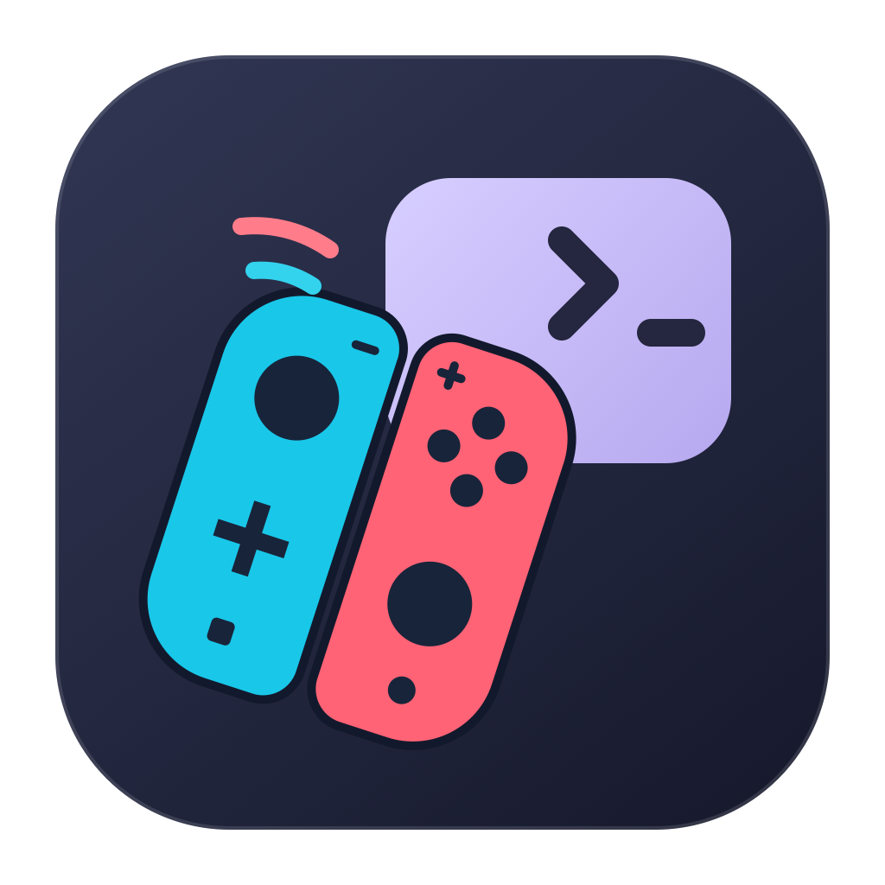
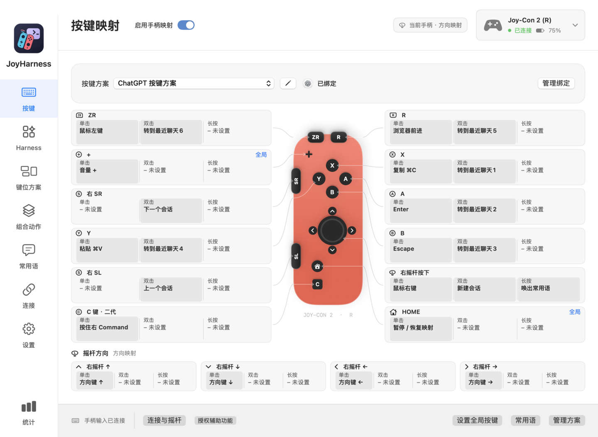

<p align="center">
  
</p>

# JoyHarness

JoyHarness 是一款原生 macOS 菜单栏应用。用 Nintendo Switch 的 Joy-Con 或 Joy-Con 2 触发快捷键、移动鼠标、输入常用语，或操作 ChatGPT、Claude、Cursor、DeepSeek、WorkBuddy、OpenCode 等应用。

**键位方案随前台 Harness 应用自动切换。** 同一只手柄可以在 ChatGPT 中发送消息，在 Cursor 中执行编辑操作。

**运行环境** · Apple Silicon Mac · macOS 15 或更新版本 · 简体中文界面

[下载最新 DMG](https://github.com/tokenzz-vip/JoyHarness/releases/latest/download/JoyHarness-macos-arm64.dmg) · [查看所有版本](https://github.com/tokenzz-vip/JoyHarness/releases) · [快速开始](#快速开始) · [反馈问题](https://github.com/tokenzz-vip/JoyHarness/issues)



## 快速开始

1. 下载并打开 Apple Silicon 版 DMG，把 `JoyHarness.app` 拖到「应用程序」。
2. 从「应用程序」打开 JoyHarness，在应用的「设置」中授予辅助功能权限。一代手柄还需要输入监控权限，二代手柄需要允许蓝牙访问。按系统提示重新打开应用。
3. 按下方步骤连接手柄，在「连接与摇杆」选择它。打开「按键映射」查看默认动作，或自行配置单击、双击与长按。

菜单栏图标可以重新打开主面板、暂停映射或重新扫描手柄。关闭主面板后，应用仍会在菜单栏运行。

## 支持的手柄

| 设备 | 接入方式 | 实现内容 |
| --- | --- | --- |
| Joy-Con (L/R) 一代 | macOS 系统蓝牙配对 → IOHID | 完整输入报告初始化、按键、12 位摇杆、电量 |
| Joy-Con 2 (L/R) 二代 | 应用内 CoreBluetooth BLE 发现与连接 | Nintendo 广播识别、通知订阅、逐命令应答初始化、按键、摇杆、电量、C 键、SL/SR |

左右独立连接，支持一代、二代及同型号多个手柄同时连接，**只有选中的一只生效**。顶部设备菜单、「连接与摇杆」和菜单栏都可以切换。切换时释放旧按键，停止摇杆和组合动作。应用会保存所选手柄，断线后等待它重连。GL/GR 需要对应的握把附件。

**当前验证状态：** 已实现两代独立接入与协议测试；自动测试不等于实机验证。尚未在两代实体手柄上验收连接、固件差异及 macOS 输入权限行为。二代 BLE 基于公开逆向协议，硬件验收清单见 [docs/behavior.md](docs/behavior.md)。

## 功能

- 菜单栏常驻，中文 SwiftUI 主面板，关闭窗口继续接收输入。
- 按所选手柄显示示意图与可用按键，一代不显示二代专属键；实时按键高亮。
- 同型号物理手柄通过设备标识区分，仅选中设备参与映射、摇杆控制、暂停恢复与统计。
- 每个按键支持单击、双击、长按，快捷键录制、应用启动、文本输入、鼠标、媒体键和组合动作。
- 在「设置 → 全局按键」管理当前手柄型号的共享按键，并在「按键映射」编辑动作。默认左手柄为 − 和截图键，右手柄为 + 和 HOME。第一项必设且不可删除，其余可留空、增删。
- 支持“打开聚焦”动作，可直接启动并聚焦 ChatGPT、Claude、Cursor、DeepSeek、WorkBuddy 或 OpenCode 的输入框。
- 左右摇杆可在方向映射与鼠标模式之间切换。连接页支持调节死区和指针速度，以及校准每只手柄的摇杆中心。
- 「连接与摇杆」中的「鼠标模式设置」可为当前手柄选择鼠标左键和右键。候选按键会排除摇杆、摇杆按下和全局按键，绑定只在鼠标模式下生效。菜单栏使用同一 JoyHarness 图形，以彩色标记鼠标模式。
- 多套键位方案，Harness 绑定应用并按前台应用自动切换；内置 ChatGPT、Claude、Cursor、DeepSeek、WorkBuddy、OpenCode 六套应用方案，左右 Joy-Con 均可使用。默认方案与当前编辑方案分开选择。
- 按键和摇杆方向在同一映射页编辑，四个方向均可配置单击、双击和长按。固定功能「切换左摇杆模式」「切换右摇杆模式」可自由绑定到任意按键，在鼠标模式和方向映射之间切换；方向动作仅在方向映射模式生效，编辑动作不会改变模式。默认使用方向映射。
- 与 RcHarness 对齐的内置 Harness：ChatGPT、Claude、Cursor、DeepSeek、WorkBuddy、OpenCode；支持添加其他应用。内置项显示安装与运行状态，WorkBuddy 兼容新旧应用标识；升级与导入配置会补齐内置项和应用方案并保留已有绑定，新 Harness 绑定对应应用方案。
- 内置与 RcHarness 对齐的 210 个组合动作；组合动作页面采用相同的双栏布局、多选标签、快捷键录制、等待时间滑块和独立滚动。名称单独保存，标签与步骤即时保存，支持嵌套引用与循环保护。启动与导入旧配置会补齐预设，保留已有动作和按键引用；已删除的预设不会在重启后恢复。
- 与 RcHarness 一致的常用语库：16 条中英文内容、五向分配、单击/双击对应两段文本；可在按键映射中把“唤出常用语”绑定到左或右摇杆按下，通过悬浮面板选择并输入。
- 「设置 → 配置导入与导出」支持 JSON 备份。导入时先预览，确认后才替换。每次替换会保留一份可在重启后恢复的配置。
- 登录启动、启动时打开主面板、Dock 显示及跟随系统/浅色/深色主题。
- 本机使用次数统计，支持今天、最近 7 天、全部范围及趋势图。
- 初始化应答匹配与有限重试；断开、暂停、休眠、方案变化时释放合成按键。

当前不包含二代光学鼠标、陀螺仪、震动、NFC、虚拟游戏手柄或麦克风驱动。暂停映射停止本应用生成的事件；原生手柄事件仍可能被游戏或其他映射工具接收。

## 连接

### 一代 Joy-Con

1. 打开 macOS「系统设置 → 蓝牙」。
2. 长按手柄侧轨上的 SYNC 按钮，选择 `Joy-Con (L)` 或 `Joy-Con (R)` 配对。
3. 运行 JoyHarness，在「设置」授予输入监控和辅助功能权限，按系统提示重新打开应用。
4. 在顶部手柄菜单或「连接与摇杆」选择要使用的手柄，必要时点击「重新扫描」。多个手柄分别配对，只有选中的一只触发映射。

### 二代 Joy-Con 2

1. 运行 JoyHarness，允许蓝牙访问。
2. 在「连接与摇杆」点击「重新扫描」，长按手柄侧面的 SYNC 按钮。
3. 应用校验 Nintendo BLE 厂商数据后连接，订阅输入和应答特征，再执行初始化；收到真实完整输入才显示「已连接」。
4. 在顶部菜单选择这只手柄，在「设置」授予辅助功能权限以发送键盘和鼠标事件。掉线后再次按 SYNC，必要时重新扫描。

首次使用时会选中第一只就绪的手柄；主动选择未连接型号后，会等待该型号的手柄。已有物理选择时，其他手柄连接或原手柄断线不会自动替换选择。切换与重连后，请先松开按键、让摇杆回中，再开始操作。

二代不要求先在系统蓝牙设置中配对。初始化失败会显示具体阶段或超时，请确认电量、关闭其他占用程序并重试。

## 默认布局

| 输入 | 动作 |
| --- | --- |
| 方向键 | macOS 方向键 |
| A / B | Enter / Escape |
| X / Y | 复制 / 粘贴 |
| L / R | 浏览器后退 / 前进 |
| ZL / ZR | 鼠标右键 / 左键 |
| − / + | 音量减 / 加 |
| 截图键 | 未设置 |
| HOME | 暂停或恢复映射 |
| 左摇杆 / 右摇杆 | 方向映射，默认发送对应方向键 |
| 左摇杆按下 / 右摇杆按下 | 鼠标左键 / 右键 |
| C（二代） | 按住右 Command，可改为语音应用的快捷键 |

设置双击或长按后，该键的单击在识别完成后触发。长按动作触发一次；仅配置单击时，按下和松开直接传递，适用于按住修饰键、鼠标拖动等场景。

## 构建

需要 Apple Silicon、Xcode 16+ / Swift 6、macOS 15+。

```bash
scripts/test_all.sh
```

本机沿用 RcHarness 的固定签名身份，也可单独指定 `JOY_HARNESS_LOCAL_SIGNING_IDENTITY`：

```bash
zsh -ic 'scripts/build_app.sh .build/JoyHarness.app'
open .build/JoyHarness.app
```

本地打包默认使用有效的签名证书。可以显式设置 `JOY_HARNESS_ALLOW_ADHOC=1` 生成临时签名构建，重新编译后通常需要再次授予系统输入权限。

`JOY_HARNESS_CONFIGURATION=debug` 可构建调试包。DMG 打包、Developer ID 签名、公证及通过版本标签发布的步骤见 [发布说明](docs/release.md)。

无需连接手柄即可导出各页截图，使用隔离的临时配置，且不会启动硬件监听或发送系统输入：

```bash
.build/JoyHarness.app/Contents/MacOS/JoyHarness --render-settings /tmp/joyharness-pages
.build/JoyHarness.app/Contents/MacOS/JoyHarness --render-settings /tmp/joyharness-dark --dark --narrow
.build/JoyHarness.app/Contents/MacOS/JoyHarness --render-settings /tmp/joyharness-right --controller joycon-2-right --populated
.build/JoyHarness.app/Contents/MacOS/JoyHarness --render-settings /tmp/joyharness-chatgpt --key-profile chatgpt --narrow
.build/JoyHarness.app/Contents/MacOS/JoyHarness --render-settings /tmp/joyharness-left --controller joycon-2-left --dark --narrow
```

## 结构

- `JoyConProtocol.swift`：两代独立解码、命令数据、初始化状态机与可注入时钟。
- `JoyConHID.swift`：一代 IOHID 设备与原始报告，按设备保留上下文。
- `JoyCon2Bluetooth.swift`：二代 BLE 发现、连接、GATT 与初始化。
- `ControllerSelection.swift` / `ControllerDeviceMenu.swift`：物理设备单选、离线型号等待、原生状态菜单。
- `InputEngine.swift`：选中设备输入隔离、按键边沿、手势、动作引用计数、摇杆、组合动作。
- `DashboardModel.swift`：权限、方案持久化、前台应用切换和生命周期。
- `DashboardView.swift` / `Editors.swift`：设置页面、控制器矢量图、编辑器。
- `SettingsStyle.swift` / `SettingsComponents.swift`：与 RcHarness 对齐的界面样式和组件。
- `StatisticsPage.swift`：按同一时间范围汇总指标、趋势和排行。
- `SystemEventSender.swift`：沿用 RcHarness 的系统事件注入接口；测试使用替代输出，不向真实会话发事件。

配置域为 `vip.tokenzz.joyharness`，键前缀 `JoyHarness.`，与 RcHarness 隔离。无效 JSON 保留至 `JoyHarness.recovery.*`。日志在 Console.app 中按 subsystem `vip.tokenzz.joyharness` 查询。

协议来源、范围和硬件验收步骤见 [行为说明](docs/behavior.md) 与 [协议依据](docs/protocol-notes.md)。

## 品牌资源

应用图标、关于页和菜单栏采用与 RcHarness 同系列的「双 Joy-Con + 指令气泡」标志，主色为手柄的蓝红。可编辑 SVG、PNG、macOS ICNS 与预览位于 `assets/brand/`，重建说明见 [品牌资源说明](assets/brand/README.md)。

## 许可证

JoyHarness 采用 [MIT 许可证](LICENSE)。复用的实现与协议资料分别记录在 [第三方声明](THIRD_PARTY_NOTICES.md) 和 [协议依据](docs/protocol-notes.md)。
